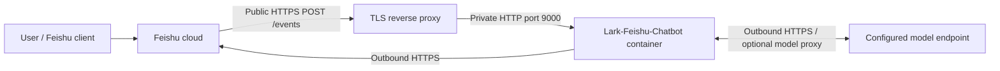

<h1 align="center">Lark-Feishu-Chatbot</h1>

[简体中文](README.md) | **English**

An AI chatbot for Feishu/Lark with streaming replies, contextual conversations, and Markdown cards for everyday questions, writing, and coding help.

## Features

- $\color{#BF8700}\textbf{Private and group chat}$: Send text directly to the bot, or @mention it in a group. Group questions, follow-ups and commands all require a bot mention.
- $\color{#BF8700}\textbf{Topic context}$: Reply within the same topic to continue a conversation; send a new root message to start fresh. Group participants share the topic's history.
- $\color{#BF8700}\textbf{Streaming Markdown}$: Read progressive card replies with lists, links and fenced code language labels. Long answers continue in additional cards; rendering depends on the Feishu client.
- $\color{#BF8700}\textbf{/help}$: Show commands and usage locally without calling the model, changing history or consuming a model question quota.
- $\color{#BF8700}\textbf{/clear}$: Reply within a topic to clear its context and cancel its active answer. Any participant in a shared group topic can clear it; existing Feishu messages remain visible.
- $\color{#BF8700}\textbf{Model protocol support}$: Select `chat-completions`, `responses` or `anthropic-messages` explicitly through `LLM_API_TYPE`. Set `LLM_BASE_URL` with the provider's version prefix and choose a compatible `LLM_MODEL`. See the [protocol reference](docs/technical-guide.md#5-model-protocol-adapters) for authentication, history and optional parameters.
- $\color{#BF8700}\textbf{Resource controls}$: Configurable history expiry, request deadlines, worker capacity and per-user quotas keep usage bounded. Wait for the current answer to finish before asking again in the same topic.

Context retains recent successful exchanges in process memory. Older pairs may be trimmed, and inactive topics may be evicted before expiry when capacity is full. Restart clears history; replicas do not share history, deduplication or quotas. Tools, vision, audio and server-managed conversation recovery are outside this service's scope.

## Network topology



## Deploy with Docker Compose

> [!IMPORTANT]
> Edit these settings in [docker-compose.yaml](docker-compose.yaml):
>
> - `FEISHU_APP_ID`: application ID.
> - `FEISHU_APP_SECRET`: application secret.
> - `FEISHU_VERIFICATION_TOKEN`: callback verification token.
> - `FEISHU_ENCRYPT_KEY`: callback encryption key; leave empty if disabled.
> - `FEISHU_BOT_NAME`: exact bot display name.
> - `LLM_API_KEY`: model API key.
> - `LLM_API_TYPE`: protocol; the template uses `chat-completions`.
> - `LLM_BASE_URL`: API base URL; the template uses DeepSeek's official `https://api.deepseek.com`.
> - `LLM_MODEL`: model ID; the template uses `deepseek-flash`.
>
> Other settings are explained inline. `.env.example` is for local development only.

Build the image from the source clone:

```sh
docker build -f Dockerfile -t lark-feishu-chatbot:local .
```

Copy only `docker-compose.yaml` to a separate, clean deployment directory. Ensure your account can manage that directory and Docker can create bind-mount directories there. Run from that deployment directory:

```sh
docker compose up -d
docker compose logs -f
```

Docker creates `./logs` beside the Compose file; application logs are saved to `./logs/chatbot.log`. The source clone is not needed in this deployment directory. See the [technical guide](docs/technical-guide.md#8-deployment-and-networking) for Feishu app setup, HTTPS and log rotation.

> [!NOTE]
> `LLM_PROXY_URL` optionally routes model requests through an HTTP(S) proxy, such as `http://proxy-host:7890`; empty means direct access. In Docker, the proxy must be reachable from the container; `localhost` means the container itself.
>
> Development and production need a public callback URL, such as `http://PUBLIC_IP:PORT/events`, provided by a server or ngrok. In Feishu, select **HTTP Webhook**, verify the URL and subscribe to `im.message.receive_v1`. Use HTTPS in production; WebSocket is unsupported. See [Feishu setup](docs/technical-guide.md#feishu-application-setup).

## Project structure

```text
Lark-Feishu-Chatbot/
├── cmd/
│   ├── lark-feishu-chatbot/  # Service startup, logging, TLS and shutdown
│   └── modelcheck/          # Model-only streaming and context diagnostic
├── internal/
│   ├── config/              # Environment parsing and validation
│   ├── logging/             # Shared terminal/file logs and command error reporting
│   ├── model/               # Model protocols, HTTP requests and SSE parsing
│   ├── state/               # Bounded history, deduplication and rate limits
│   ├── chat/                # Conversation lifecycle and stream coordination
│   └── feishu/              # Callbacks, Markdown cards and message transport
├── docs/                    # Design, migration and validation records
├── .env.example             # Tracked template for local development
├── .env/                    # Ignored local configuration directory
│   └── .env.example         # Developer's copy loaded by the VS Code debugger
├── docker-compose.yaml      # Deployment settings and container topology
├── Dockerfile
├── go.mod
├── README.md                # Chinese guide (default)
└── README.en.md             # English guide
```

## Develop in VS Code

**Copy `.env.example` to `.env/.env.example` and fill in your credentials.** Entry points are under `cmd/`; use the provided launch configurations in VS Code's Run and Debug GUI as a reference.

> [!TIP]
> Keep private instance files in Git-ignored `ignore/`. See the [technical guide](docs/technical-guide.md#10-development-and-verification) for development details and [AGENTS.md](AGENTS.md#readme-style) for documentation style and contributor rules.

## License and provenance

Copyright (c) 2026 Lark-Feishu-Chatbot contributors. This project is licensed under the [Apache License, Version 2.0](LICENSE) (`Apache-2.0`). Third-party components retain their own licenses; see [third-party notices](licenses/THIRD_PARTY_NOTICES). Docker images include the project license and third-party notices under `/licenses/`.
