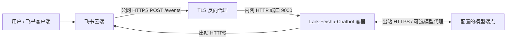

<h1 align="center">Lark-Feishu-Chatbot</h1>

**简体中文** | [English](README.en.md)

支持流式回复、上下文对话和 Markdown 卡片的飞书/Lark AI 机器人，可用于日常问答、写作和编程辅助。

## 功能

- $\color{#BF8700}\textbf{私聊与群聊}$：私聊直接发送文本，群聊需在每次提问、追问或发送命令时 @机器人。
- $\color{#BF8700}\textbf{话题上下文}$：在同一话题内回复可延续对话，新发一条根消息则开启独立话题。群成员共享话题上下文。
- $\color{#BF8700}\textbf{流式 Markdown}$：卡片逐步展示回复，支持列表、链接和代码块语言标记。长回复自动续卡，实际样式取决于飞书客户端。
- $\color{#BF8700}\textbf{/help}$：本地显示命令和用法，不调用模型、不改变历史，也不消耗模型提问配额。
- $\color{#BF8700}\textbf{/clear}$：在话题内回复此命令可清除上下文并取消正在生成的回答。群话题的任意参与者均可操作，已有飞书消息仍会保留。
- $\color{#BF8700}\textbf{模型协议}$：通过 `LLM_API_TYPE` 明确选择 `chat-completions`、`responses` 或 `anthropic-messages`。`LLM_BASE_URL` 需包含服务商要求的版本前缀，`LLM_MODEL` 需与端点兼容。认证、历史和可选参数见[协议说明](docs/technical-guide.md#5-model-protocol-adapters)。
- $\color{#BF8700}\textbf{资源控制}$：可配置上下文过期时间、请求时限、并发容量和用户配额。同一话题需等待当前回答结束后再提问。

上下文只保留在进程内存中的近期成功对话。旧对话可能被裁剪，容量满时未过期的空闲话题也可能被淘汰。重启会清空历史，多副本不共享历史、去重记录和配额。暂不支持工具调用、图像、音频或服务端会话恢复。

## 网络拓扑



## Docker Compose 部署

> [!IMPORTANT]
> 修改 [docker-compose.yaml](docker-compose.yaml) 中的以下配置：
>
> - `FEISHU_APP_ID`：飞书应用 ID。
> - `FEISHU_APP_SECRET`：飞书应用密钥。
> - `FEISHU_VERIFICATION_TOKEN`：回调验证令牌。
> - `FEISHU_ENCRYPT_KEY`：回调加密密钥，未启用时留空。
> - `FEISHU_BOT_NAME`：与飞书中完全一致的机器人名称。
> - `LLM_API_KEY`：模型 API 密钥。
> - `LLM_API_TYPE`：模型协议，模板使用 `chat-completions`。
> - `LLM_BASE_URL`：API 基础地址，模板使用 DeepSeek 官方的 `https://api.deepseek.com`。
> - `LLM_MODEL`：模型 ID，模板使用 `deepseek-flash`。
>
> 其他配置见文件内注释。`.env.example` 仅用于本地开发。

在源码目录中构建镜像：

```sh
docker build -f Dockerfile -t lark-feishu-chatbot:local .
```

将 `docker-compose.yaml` 单独复制到一个干净的部署目录，确保当前用户可管理该目录，且 Docker 有权创建挂载目录。在部署目录中运行：

```sh
docker compose up -d
docker compose logs -f
```

Docker 会在 Compose 文件旁创建 `./logs`，应用日志写入 `./logs/chatbot.log`。部署目录无需保留源码。飞书应用配置、HTTPS 和日志轮转见[技术指南](docs/technical-guide.md#8-deployment-and-networking)。

> [!NOTE]
> `LLM_PROXY_URL` 可为模型请求设置 HTTP(S) 代理，例如 `http://proxy-host:7890`，留空则直连。代理地址必须能从容器访问；容器内的 `localhost` 指容器自身。
>
> 开发和生产环境均需通过服务器或 ngrok 提供公网回调地址，例如 `http://PUBLIC_IP:PORT/events`。在飞书开发者平台选择 **HTTP Webhook**，完成地址验证并订阅 `im.message.receive_v1`。生产环境请使用 HTTPS，暂不支持 WebSocket。详见[飞书配置](docs/technical-guide.md#feishu-application-setup)。

## 项目结构

```text
Lark-Feishu-Chatbot/
├── cmd/
│   ├── lark-feishu-chatbot/  # 服务启动、日志、TLS 与关闭
│   └── modelcheck/          # 独立的模型流式响应与上下文诊断
├── internal/
│   ├── config/              # 环境变量解析与校验
│   ├── logging/             # 终端与文件日志、命令错误报告
│   ├── model/               # 模型协议、HTTP 请求与 SSE 解析
│   ├── state/               # 有界历史、去重与限流
│   ├── chat/                # 对话生命周期与流式输出协调
│   └── feishu/              # 回调、Markdown 卡片与消息传输
├── docs/                    # 设计、迁移与验证记录
├── .env.example             # 本地开发配置模板
├── .env/                    # Git 忽略的本地配置目录
│   └── .env.example         # VS Code 调试器读取的开发者副本
├── docker-compose.yaml      # 部署配置与容器拓扑
├── Dockerfile
├── go.mod
├── README.md                # 中文说明（默认）
└── README.en.md             # 英文说明
```

## VS Code 开发

**复制 `.env.example` 到 `.env/.env.example` 并填写凭据。** 启动入口位于 `cmd/`，可参考项目提供的启动配置，通过 VS Code 的“运行和调试”界面启动。

> [!TIP]
> 私有实例文件放在 Git 忽略的 `ignore/` 中。开发详情见[技术指南](docs/technical-guide.md#10-development-and-verification)，文档风格与贡献规则见 [AGENTS.md](AGENTS.md#readme-style)。

## 许可与来源

Copyright (c) 2026 Lark-Feishu-Chatbot contributors. 本项目采用 [Apache License, Version 2.0](LICENSE)（`Apache-2.0`）。第三方组件保留各自许可，详见[第三方声明](licenses/THIRD_PARTY_NOTICES)。Docker 镜像在 `/licenses/` 中包含项目许可和第三方声明。
