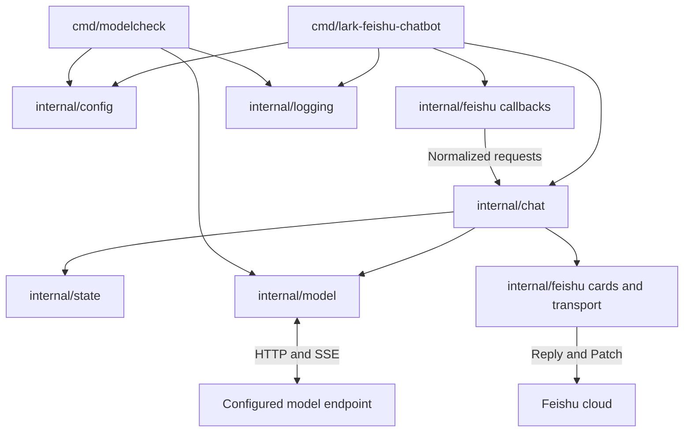
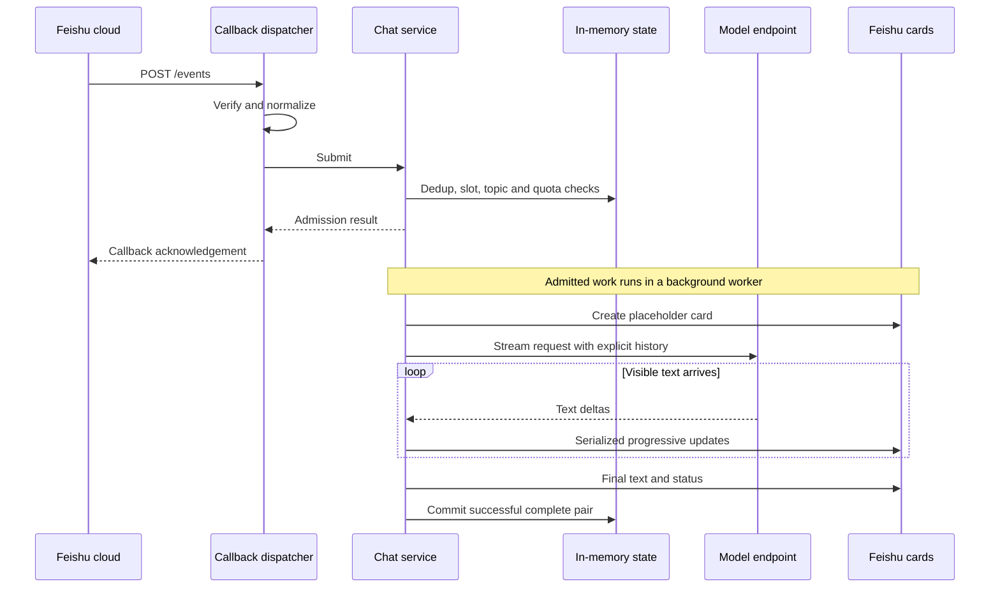
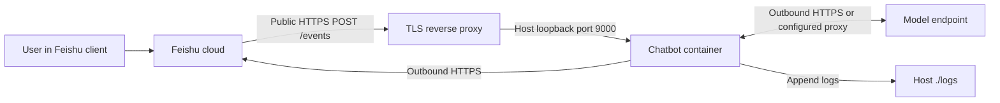

# Lark-Feishu-Chatbot Technical Guide

This document consolidates the project analysis, state audit, model protocol comparison, service design, implementation plan, migration notes and validation record. It describes the current source tree; historical findings are identified separately. Example values come from the configuration templates and are not fallback defaults in Go.

## Contents

1. [Purpose and supported behavior](#1-purpose-and-supported-behavior)
2. [Architecture and source layout](#2-architecture-and-source-layout)
3. [Message lifecycle and commands](#3-message-lifecycle-and-commands)
4. [State, history and concurrency](#4-state-history-and-concurrency)
5. [Model protocol adapters](#5-model-protocol-adapters)
6. [Markdown cards and streaming](#6-markdown-cards-and-streaming)
7. [Configuration reference](#7-configuration-reference)
8. [Deployment and networking](#8-deployment-and-networking)
9. [Logging and operations](#9-logging-and-operations)
10. [Development and verification](#10-development-and-verification)
11. [Migration and historical decisions](#11-migration-and-historical-decisions)
12. [Known limits and future changes](#12-known-limits-and-future-changes)
13. [Licensing and source records](#13-licensing-and-source-records)

## 1. Purpose and supported behavior

Lark-Feishu-Chatbot is a Go HTTP service that accepts authenticated Feishu message callbacks, streams a configured text model's answer into Markdown cards, and retains bounded context for replies in the same topic.

| User action or capability | Current behavior |
| --- | --- |
| Private text | Send a text message directly to the bot |
| Group text | Mention the configured bot in every question, follow-up and command |
| Follow-up | Reply within the same root topic to reuse its successful conversation history |
| New conversation | Send a new top-level message outside an existing topic |
| Streaming | Read progressive card updates while the model generates |
| Rich text | Native Markdown, fenced code language labels and continuation cards |
| `/help` | Local command/usage guide; no model call, history mutation or model quota charge |
| `/clear` | Remove current-topic history and cancel its active generation; does not delete Feishu messages |
| Inactivity | Context expires after the configured retention period; no expiry notification |
| Request protection | Total and visible-text idle deadlines, per-topic serialization and global worker limits |
| Usage controls | Optional per-user rolling-minute and UTC-day attempt quotas |
| Operations | Structured stdout, optional file logging, health endpoint and optional direct HTTPS |

Only `/help` and `/clear` are local commands. Commands must match after trimming surrounding whitespace. Unknown command-like text is ordinary model input. Help and notices still require a worker slot; `/clear` removes topic state before worker admission, so cancellation may take effect even when its confirmation cannot be admitted.

Roles/scenes, image/audio workflows, billing, tool execution, history recovery, PPT generation, group summaries, mention-free group participation and automatic key failover are not implemented. The configured model may answer writing or coding questions through ordinary text, without a dedicated workflow for those tasks.

Despite the project name, the platform API origin is currently fixed to Feishu's `https://open.feishu.cn`. A separately configurable international Lark origin and persistent-connection event transport are not implemented.

## 2. Architecture and source layout



| Path | Responsibility |
| --- | --- |
| `cmd/lark-feishu-chatbot/` | Configuration composition, logger, TLS, listener, signals and shutdown |
| `cmd/modelcheck/` | Model-only two-turn streaming/context diagnostic |
| `internal/config/` | Direct environment parsing and typed validation |
| `internal/logging/` | Shared JSON terminal/file output, standard logger routing and command error reporting |
| `internal/model/` | Request envelopes, authentication, HTTP transport, SSE and terminal validation |
| `internal/state/` | Bounded sessions, generation ownership, deduplication and quota counters |
| `internal/chat/` | Admission, background requests, buffering, deadlines and serial output |
| `internal/feishu/` | SDK callback authentication, message normalization, Markdown and Reply/Patch |
| `.vscode/` | Service/diagnostic debug configurations and Markdown preview style |
| `.env.example` | Tracked development template |
| `.env/.env.example` | Ignored developer-local configuration |
| `docker-compose.yaml` | Literal deployment configuration and container settings |
| `docs/` | This guide and supporting historical/design/validation records |
| `AGENTS.md` | Repository instructions for coding agents |

Entry points compose components; business behavior belongs in `internal/`. Go restricts imports of internal packages to the containing parent tree. The project deliberately uses `cmd/` and `internal/` without a Java-style `src/` layer. Docker's builder working directory `/src` is a container path, not a repository layout requirement.

The recorded implementation baseline is Go `1.27.3` and `github.com/larksuite/oapi-sdk-go/v3 v3.12.2`. The SDK module graph includes `github.com/gogo/protobuf v1.3.2` and `github.com/gorilla/websocket v1.5.0`. Neither is compiled into the current commands because they do not import the SDK WebSocket packages. No explicit module exclusion is needed; Go selects packages from actual imports. Model adapters and the HTTP server use the standard library. These are recorded versions, not a promise that they will remain the latest releases.

## 3. Message lifecycle and commands

### Source reading route

Search for the literal marker `[Main Request]` to follow numbered comments at key call sites and implementations. Search `[Main Request] 07`, for example, to follow admission across callback dispatch, the chat coordinator and topic state. The numbers describe phases; repeated numbers connect implementations within a phase rather than imposing execution order on concurrent goroutines.

| Marker | Source entry points | Follow this responsibility |
| --- | --- | --- |
| `01 Entry` | `cmd/lark-feishu-chatbot/main.go`: `main` | Enter `main -> run -> serve` |
| `02 Logging` | `main.go`: `run`; `internal/logging/logging.go`: `Run` | Initialize terminal/file logging and report errors before closing it |
| `03 Bootstrap` | `main.go`: `serve`; `internal/config/config.go`: `Load`; `server.go`: `serverTLS`; `internal/model/model.go`: `New`; `internal/chat/service.go`: `New` | Validate settings/certificates and assemble the model, chat state and Feishu output dependencies |
| `04 HTTP` | `main.go`: route registration and listener | Register `/events` and `/healthz`, then wait for a signal or listener failure |
| `05 Callback` | `internal/feishu/events.go`: `NewHandler` | Bound HTTP bodies before SDK authentication, decryption and event dispatch |
| `06 Normalize` | `events.go`: `normalize` | Accept private text or mentioned group text and form `chat_id/root_id` topics |
| `07 Admission` | `events.go`: `service.Submit`; `internal/chat/service.go`: `Submit`; `internal/state/sessions.go`: `Begin`, `Clear` | Validate, deduplicate, handle commands, reserve a worker/topic and check quotas without network I/O |
| `08 Worker` | `service.go`: background goroutine; `internal/feishu/transport.go`: `Sink.Open`; `sessions.go`: `End` | Create the placeholder, send local replies or enter generation, and release reservations on exit |
| `09 Generation` | `service.go`: call to `s.run`; `internal/chat/worker.go`: `run` | Use copied history, a bounded answer buffer and request/visible-text idle cancellation |
| `10 Model` | `worker.go`: `provider.Stream`; `internal/model/model.go`: `request`; `http.go`: `Stream`; `sse.go`: `readSSE` | Encode the explicit protocol, send HTTP and return validated text deltas or a terminal error |
| `11 Cards` | `worker.go`: update loop; `transport.go`: `output.Update`, `SDKAPI.Reply`, `SDKAPI.Patch`; `cards.go`: `splitMarkdown` | Serialize progressive card updates and continuation rendering in one worker |
| `12 Finalize` | `worker.go`: completion path and `final`; `sessions.go`: `Commit` | Preserve final/partial text, send final status, commit only successful complete exchanges and log the answer once |
| `13 Shutdown` | `main.go`: shutdown path; `service.go`: `Shutdown` | Stop admission, cancel workers and drain HTTP concurrently within the shutdown deadline |

Startup assembles dependencies and starts listening before any message is processed. The SDK then routes each supported callback into `chat.Service.Submit`, which returns after admission while its bounded worker continues independently of the callback context. That worker creates the placeholder before `worker.run` starts model generation. Model callbacks only append text; the worker owns card updates and finalization. Shutdown starts worker cancellation alongside HTTP draining, rather than waiting for HTTP draining before canceling generation.

### HTTP surface

| Method | Route | Purpose |
| --- | --- | --- |
| POST | `/events` | SDK-authenticated message callback and URL challenge |
| GET | `/healthz` | Process availability; returns `ok` without calling external services |

The official Feishu dispatcher handles verification tokens, encrypted payloads and signatures. Callback bodies have a fixed 1 MiB wire ceiling. This safety bound is separate from deployment tuning and conversation budgets.

Message normalization accepts human `text` events. It uses `open_id`, falling back to `user_id`, and rejects missing required IDs, malformed content, bot senders and unsupported message types. Private `p2p` messages need no mention; groups need a mention whose display name matches `FEISHU_BOT_NAME`. Multiple mentions are allowed. Only the matched bot's placeholder is removed, preserving ordinary emails and at signs in text.



`Submit` performs no network calls. Its short admission path is independent of model generation, so the callback does not wait for the answer. The worker uses the service lifetime rather than the HTTP callback context. Errors during admission are returned to the callback dispatcher; admission does not guarantee subsequent model or card success.

A topic is `chat_id/root_id`, falling back to `chat_id/message_id` for a new root. Group participants share the same topic history and can clear it. Sending `/clear` as an unrelated top-level message clears that new topic, so clearing an existing conversation requires replying within it.

### Cancellation and finalization

The total request deadline starts after worker-slot admission and includes initial card creation. An independent visible-text timer detects an empty first response or later stall; whitespace and SSE heartbeats do not renew it. Clear and service shutdown also cancel upstream work. Card writes are bounded, and a blocked write can be canceled by the generation deadline.

A fresh bounded service context attempts the final/error card even after a generation deadline. Consequently finalization can take an additional write timeout. Partial text can remain visible after failure, but is not committed as successful history. A topic generation token prevents a canceled or cleared worker from restoring old context.

## 4. State, history and concurrency

The service is stateful within one process. It has no database, Redis, persistent queue or conversation reconstruction from Feishu history/logs.

| State | Key / owner | Bound and lifecycle |
| --- | --- | --- |
| Successful exchanges | Chat/root topic | `SESSION_MAX_COUNT`, `SESSION_TTL`, message/rune budgets |
| Active generation | Topic plus generation token and cancellation function | One active model generation per topic |
| Deduplication | Incoming message ID | `DEDUPE_MAX_COUNT`, `DEDUPE_TTL` |
| User quota | Feishu sender ID | `RATE_LIMIT_MAX_USERS`, rolling minute and UTC day |
| Worker admission | Service slot channel | `MAX_CONCURRENT_REQUESTS`, including notice workers |
| Feishu tokens | SDK memory cache | SDK/platform expiry; can be obtained again |
| Generation buffers | Worker | Answer rune bound and request lifetime |
| Settings/clients | Process | Startup configuration and reusable connection pools |

Restart loses history, counters, deduplication and active work. Replicas do not share state and can produce incomplete conversations or independent quota decisions. A log mount preserves logs, not sessions.

### Session rules

Only a complete successful user/assistant pair is stored, after both model completion and successful final output. History is copied for each request and old complete pairs are removed to satisfy message/rune budgets. An input larger than the rune budget is rejected. The system prompt is configured separately from mutable conversation pairs.

A successful commit renews `SESSION_TTL`; reading history or calling `/help` does not. Expired entries are removed during later session admission. At full capacity, the inactive topic with the earliest expiration can be evicted before its TTL. Busy topics are not evicted; admission fails if no inactive topic can be reclaimed.

A rune budget counts Unicode code points, not tokens, serialized bytes or the provider's full context window. It does not include all protocol/instruction overhead. The same configured rune limit bounds generated answer accumulation; exceeding it fails the answer rather than silently growing the buffer.

### Deduplication and quotas

Message claiming is atomic. Repeated live IDs are acknowledged without another worker. Expired IDs are reclaimed when claiming later IDs. A full deduplication store rejects new admission. If global worker capacity rejects a newly claimed message, its claim is released so a later delivery may retry.

Per-user quotas are checked only for a newly admitted model generation, after topic reservation. Failed model attempts can count. `/help`, `/clear`, duplicates and topic-busy notices do not consume model-question quota. `ACCESS_CONTROL_ENABLE=false` bypasses quota checks and quota-user tracking; a zero minute/day value disables that individual quota. Global workers and deduplication remain active.

The minute quota is rolling; the day quota resets at a UTC date boundary. Counter maintenance and increments use locks. User capacity remains bounded and unused entries are reclaimed when their quota windows allow it. A full quota-user store can reject a new user even if their own count would otherwise be zero.

## 5. Model protocol adapters

A provider brand, a wire protocol and a model ID are different configuration choices. Set `LLM_API_TYPE`, `LLM_BASE_URL`, `LLM_MODEL` and one credential explicitly. No routing is inferred from a model/provider name, and no Azure-specific backend mode or multi-key selection is implemented.

| Type | Appended path | Authentication | Input / instructions | Output-token field | Terminal signal |
| --- | --- | --- | --- | --- | --- |
| `chat-completions` | `/chat/completions` | Bearer key | `messages`, optional system message | `max_tokens` | `[DONE]` |
| `responses` | `/responses` | Bearer key | `input`, optional `instructions`; `store:false` | `max_output_tokens` | `response.completed` |
| `anthropic-messages` | `/messages` | `x-api-key`, `anthropic-version` | `messages`, optional top-level `system` | `max_tokens` | `message_stop` |

The user includes any version prefix in the base URL. For example, a base ending in `/v1` receives only the resource above; the service never inserts `/v1`. Trailing slashes are normalized. Non-HTTP(S), missing hosts, embedded base-URL credentials, query strings and fragments are rejected.

The portable `model.Message` contains role and text. The service replays user/assistant history for every protocol. Responses does not rely on a remote response ID or server-managed recovery. Provider-side retention remains independent of application memory and `store:false`.

`Streamer.Stream(ctx, messages, emit)` emits visible text and returns one terminal result. The adapter rejects HTTP errors, malformed JSON, truncated streams, unsupported terminal reasons and successful-looking streams without visible text. It extracts Chat Completions content deltas, Responses output-text deltas, and Messages text-block deltas. Unknown non-text fields are ignored; tool-only results are not accepted as complete text answers.

SSE parsing handles fragmented network reads, CRLF, comments, multiline data and a final event without a blank trailing delimiter. A fixed 4 MiB event bound includes wire lines and comments, including repeated empty data fields. EOF without the required terminal event is failure.

Production model requests use a reusable HTTP transport, request-context cancellation and disabled redirects. `LLM_PROXY_URL` explicitly configures an HTTP(S) model proxy; empty means direct model access, even when ambient proxy variables exist. It does not configure Feishu traffic. Error response bodies are drained only within a small bound and are not surfaced with arbitrary content or credentials. There is no application-level model retry, key rotation or failover.

## 6. Markdown cards and streaming

Feishu messages use interactive card schema `2.0` with native Markdown elements and a separate status. A placeholder appears before model text. A single output owner applies card changes in order; unchanged content is skipped, progressive updates use `CARD_UPDATE_INTERVAL`, and terminal updates are immediate.

Long answers split into continuation cards under `CARD_MAX_RUNES`, with room reserved for code-fence balancing. Unicode splitting operates on runes. Incomplete fenced blocks are balanced in the displayed fragments and reopened with their language label on continuation cards. Stored model output remains unchanged. Previously displayed surplus fragments are replaced with a continuation notice if later fence completion changes the split.

Actual Markdown and syntax coloring depend on the Feishu client and its supported languages. There is no custom HTML/CSS code highlighter. Application update cadence is not a guarantee about platform quotas; card errors fail the current output path rather than invoking an application-specific retry/backoff loop.

## 7. Configuration reference

All service settings are environment variables parsed directly into typed groups. There is no application YAML loader, dotenv loader, reflection mapper or hidden deployment default. Missing required settings fail startup with field-based errors, without printing values. Changes require process/container recreation.

The tracked [.env.example](../.env.example) and [docker-compose.yaml](../docker-compose.yaml) contain the same 40 application settings, in the same order, with matching sample values and individual English comments. Development copies the former into ignored local storage; deployment edits literal values in the latter. The values below are examples, not production credentials.

| Variable | Example | Meaning and validation |
| --- | --- | --- |
| `HTTP_ADDR` | `:9000` | Explicit host/port for the selected HTTP or HTTPS mode |
| `HTTP_READ_TIMEOUT` | `10s` | Positive duration for callback headers/body and idle HTTP connections |
| `HTTP_WRITE_TIMEOUT` | `15s` | Positive duration for callback responses, Feishu API and card writes |
| `SHUTDOWN_TIMEOUT` | `15s` | Positive application shutdown budget; container stop time is managed separately |
| `USE_HTTPS` | `false` | Explicit boolean selecting direct TLS or plain HTTP |
| `CERT_FILE` | `certs/server.crt` | PEM chain required when HTTPS is enabled |
| `KEY_FILE` | `certs/server.key` | Matching readable PEM private key required for HTTPS |
| `FEISHU_APP_ID` | `replace-me` | Required application ID |
| `FEISHU_APP_SECRET` | `replace-me` | Required application secret |
| `FEISHU_VERIFICATION_TOKEN` | `replace-me` | Required callback verification token |
| `FEISHU_ENCRYPT_KEY` | Empty | Optional encryption key; empty permits token-authenticated plaintext callbacks |
| `FEISHU_BOT_NAME` | `Lark-Feishu-Chatbot` | Required exact group-mention display name |
| `LLM_API_TYPE` | `chat-completions` | One of the three supported protocol names |
| `LLM_BASE_URL` | `https://api.deepseek.com` | Required HTTP(S) base including any provider version path |
| `LLM_API_KEY` | `replace-me` | Required single model credential |
| `LLM_MODEL` | `deepseek-flash` | Required exact model ID supported by the selected protocol |
| `LLM_MAX_OUTPUT_TOKENS` | `2048` | Positive token cap sent to the provider |
| `LLM_TEMPERATURE` | Empty | Optional finite number from 0 to 2; empty omits the field |
| `LLM_SYSTEM_PROMPT` | Empty | Optional system instruction, separate from topic history |
| `LLM_ANTHROPIC_VERSION` | `2023-06-01` | Required Messages version header; ignored by other protocols |
| `LLM_PROXY_URL` | Empty | Optional HTTP(S) proxy for model requests only |
| `REQUEST_TIMEOUT` | `120s` | Positive total admitted-request deadline |
| `STREAM_IDLE_TIMEOUT` | `30s` | Positive interval without visible text before cancellation |
| `MAX_CONCURRENT_REQUESTS` | `8` | Positive global worker capacity, including notices |
| `SESSION_TTL` | `12h` | Positive retention since the last successful topic commit |
| `SESSION_MAX_COUNT` | `1000` | Positive topic capacity; inactive entries can be evicted |
| `HISTORY_MAX_MESSAGES` | `40` | At least 2; trim oldest complete exchange pairs |
| `HISTORY_MAX_RUNES` | `24000` | Positive input/history and answer rune bound; not tokens |
| `DEDUPE_TTL` | `30m` | Positive incoming-message suppression interval |
| `DEDUPE_MAX_COUNT` | `10000` | Positive deduplication capacity |
| `ACCESS_CONTROL_ENABLE` | `true` | Explicit boolean enabling quotas and user tracking |
| `RATE_LIMIT_PER_MINUTE` | `20` | Nonnegative rolling-minute model attempts; 0 disables |
| `RATE_LIMIT_PER_DAY` | `200` | Nonnegative UTC-day model attempts; 0 disables |
| `RATE_LIMIT_MAX_USERS` | `10000` | Positive tracked quota-user capacity |
| `CARD_UPDATE_INTERVAL` | `1s` | Positive interval between progressive card refreshes |
| `CARD_MAX_RUNES` | `6000` | At least 128; Markdown fragment bound with fence headroom |
| `ENABLE_LOG` | `true` | Explicit boolean enabling file mirroring; stdout stays active |
| `LOG_LEVEL` | `info` | Application severity threshold, for example debug/info/warn/error |
| `LOG_CONTENT` | `true` | Explicit boolean; true records user inputs and replies in terminal/file logs |
| `LOG_FILE` | `logs/chatbot.log` | File path required when file logging is enabled; relative to cwd |

A syntactically valid placeholder passes field parsing but cannot authenticate. Provider-specific parameter support can be narrower than local validation; for example, omit temperature for a model that rejects it. Conditional certificate/log paths are not required when their respective feature is disabled. Other numeric settings remain explicit even when an associated quota is disabled.

## 8. Deployment and networking

### Supported deployment workflow

Docker Compose is the documented deployment method. Edit literal values in `docker-compose.yaml` using the required-settings checklist in the README:

- `FEISHU_APP_ID`, `FEISHU_APP_SECRET`: application credentials.
- `FEISHU_VERIFICATION_TOKEN`: event verification token.
- `LLM_API_KEY`: model credential.
- `FEISHU_BOT_NAME`: exact bot display name.
- `LLM_API_TYPE`, `LLM_BASE_URL`, `LLM_MODEL`: provider-compatible protocol, endpoint and model.

Set `FEISHU_ENCRYPT_KEY` when callback encryption is enabled. These are the minimum edits to the complete template, not the complete set of environment variables required by the application. Keep the remaining explicit settings and consult their individual comments for optional changes. The README keeps public callback setup brief; the Feishu application setup section below retains routing and verification details.

The templates use DeepSeek's official OpenAI-compatible API at `https://api.deepseek.com`, with model `deepseek-flash` and protocol `chat-completions`. These are example settings, not built-in defaults or evidence of a live connectivity check. Use a credential issued for the chosen provider.

Build the image from the source clone:

```sh
docker build -f Dockerfile -t lark-feishu-chatbot:local .
```

Copy only `docker-compose.yaml` to a separate, clean deployment directory. Ensure the operator can manage that directory and Docker can create and write bind-mount directories there. Start the prebuilt image from the deployment directory:

```sh
docker compose up -d
docker compose logs -f
```

The build tag matches Compose's `image`. Build it before startup; the manifest has no `build` entry. The deployment directory does not need the source clone. Docker creates `./logs` beside the Compose file for the short bind-mount syntax; manual log-directory creation is unnecessary. Existing directories must allow the container to write. Without an explicit pull policy, Docker Compose may try to pull the image if it is absent locally. After source changes, rebuild the image before recreating the service. Deployment does not read a dotenv file or require command-line environment arguments. The README keeps this workflow brief; the manifest and `.env.example` retain the same full list of settings, sample values, order and per-setting English comments.



The sample publishes `127.0.0.1:9000:9000`. A host reverse proxy can reach that loopback listener. A proxy in another container needs an explicitly appropriate shared-network route or port binding; its own loopback does not refer to the Docker host. No reverse proxy is included in this repository.

For outbound model access through an HTTP(S) proxy, set `LLM_PROXY_URL` to an address reachable from the service, such as `http://proxy-host:7890`. Empty uses direct model access and ignores ambient proxy variables. The setting does not proxy Feishu API calls or expose inbound callbacks. In Docker, `localhost` refers to the chatbot container; use the proxy's reachable host or network address instead. This outbound proxy is separate from the inbound reverse proxy or development tunnel.

The template and private manifests retain only `container_name`, `image`, `restart: always`, `ports`, `volumes` and `environment` within each service. The log bind mount is writable; no container user override, certificate mount, stop grace period, logging driver options or other runtime options are configured. The Dockerfile has no `USER` instruction, so the image uses root by default. With ordinary rootful Docker, root-owned log directories do not require an ownership change. Docker controls its own stop timeout, which may end the process before the configured application shutdown budget completes.

### Private instance manifests

Local deployment files under Git-ignored `ignore/` may contain real credentials. Keep them out of commits and diagnostic output. Each bot instance needs its own Compose project/container name, published host port and log directory; they may share the same prebuilt image. Copy each manifest into its own clean deployment directory. Relative bind mounts resolve beside the Compose file, and Docker creates missing log directories there when permissions allow. The default root container user can write ordinary root-owned directories. The private manifests omit top-level project-name overrides; use separate deployment directories or Compose project names when running both.

When migrating old deployments, copy Feishu/model credentials and bot names into the current environment names, preserve the host ports, and provide all settings from the current template. The old model client appended `/v1` to `API_URL`; include that prefix explicitly in `LLM_BASE_URL`. Private instance files may omit comments while retaining the public template's application-setting order; consult the annotated root templates for descriptions. Choose host ports for the deployment and map them to container port `9000`. Compose interpolation requires literal dollar signs in credentials to be escaped as `$$`.

### Image contents

The Go builder copies `go.mod`, `go.sum`, `cmd/` and `internal/`, downloads modules and builds a static Linux binary. The final `scratch` image contains the binary, CA roots and license notices, with working directory `/app`. No `USER` instruction is set, and Compose does not override the user, so the service runs as root. Rebuild the image and recreate existing containers for a Dockerfile user change to take effect; restarting an existing container retains its original image configuration.

`.dockerignore` allows the required source/module/license inputs. `COPY cmd` and `COPY internal` therefore agree with the build-context allowlist. Local environment files, logs and certificates are excluded from the image. The template mounts logs; direct HTTPS requires adding a suitable read-only certificate mount. Scratch has no shell or package manager, so use host/container tooling rather than expecting an interactive container shell.

### TLS modes

With `USE_HTTPS=false`, terminate public TLS at a reverse proxy and forward callbacks to plain HTTP. With `USE_HTTPS=true`, add a read-only mount for a valid PEM certificate chain and matching private key at the configured paths; the minimal manifests do not include this mount. Startup checks that the pair loads, the leaf parses and its validity period includes the current time. Minimum TLS is 1.2.

HTTP and HTTPS use the same `HTTP_ADDR` and exactly one mode is active. Change host publishing/firewall rules for a direct public listener. Certificate paths are relative to `/app` in the container; the configured user must read the key. There is no certificate hot reload or automatic issuance; replace certificates and recreate the service when needed.

### Feishu application setup

Both local development and production need a callback endpoint reachable from the public Internet. A public server IP/domain with appropriate port forwarding or a reverse proxy can provide it; local development can use an ngrok tunnel to the service's HTTP port. The machine running the bot does not need its own public IP when a tunnel supplies that public endpoint. The sample loopback-only port publishing requires a reachable frontend or an explicitly changed binding before Feishu can connect.

In the Feishu developer console, open the bot application's Events & callbacks > Event configuration and select Send notifications to developer's server. This service implements traditional HTTP Webhook callbacks, without WebSocket persistent connections. Configure the full request URL, for example `http://PUBLIC_IP:PORT/events` or `https://your-domain/events`, using HTTPS for production. The port is the externally reachable port, which may differ from `HTTP_ADDR` behind a proxy or Docker port mapping. Keep `/events`: the root path `/` has no callback handler and returns 404, which can cause a non-JSON response error during platform verification.

Keep the service and any tunnel/proxy running, permit inbound traffic at the public frontend, and save the URL to complete challenge verification. Match `FEISHU_VERIFICATION_TOKEN` and `FEISHU_ENCRYPT_KEY` to the platform's security settings. Enable and publish the bot, configure its availability, subscribe to `im.message.receive_v1`, and grant message receive/send permissions for private/group usage. Match the configured bot display name exactly. The code supports `open_id` without requiring optional `user_id` access. See Feishu's official [server event subscription guide](https://open.feishu.cn/document/event-subscription-guide/event-subscriptions/event-subscription-configure-/choose-a-subscription-mode/send-notifications-to-developers-server) and [local development tutorial](https://open.feishu.cn/document/home/develop-a-bot-in-5-minutes/step-5-configure-event-subscription) for platform setup and public callback access.

An HTTP health response proves only that the process is listening. It does not prove Feishu event delivery, authorization, model access, card updates or Markdown rendering.

## 9. Logging and operations

Both commands initialize `internal/logging` before loading model or service settings. Logs use `slog` JSON with the configured level, and standard-library logger output uses the same handler. `ENABLE_LOG=true` mirrors identical records to stdout and an append-only `LOG_FILE`; false leaves stdout diagnostics active. The example path becomes `./logs/chatbot.log` on the host. Configuration and runtime errors are logged before closing the file. If logging settings are invalid or the enabled file cannot be created/opened, startup fails with a terminal JSON error because file logging is unavailable.

The minimal Compose files do not configure Docker log rotation; container stdout/stderr retention follows Docker daemon settings. The mounted application log has no internal rotation. Manage application-file retention/rotation on the host, accounting for the process's open file handle and recreating/restarting it when reopening is required.

The templates enable `LOG_CONTENT=true`: each admitted unique user input is recorded once by its bounded worker before card creation, including commands and inputs whose card creation fails. Each model answer is recorded once after completion, or with the partial text received when generation is interrupted. Logging stays outside the admission mutex so slow destinations do not block callback admission or shutdown cancellation. System failures such as configuration, model/network, card creation/update and callback errors are separate structured error records with their sanitized reasons. The model diagnostic records each prompt once and each complete or interrupted answer once; it never logs individual stream chunks. `LOG_CONTENT=false` omits conversation text from both terminal and file while retaining operational logs. Logs avoid complete configuration, credentials and arbitrary provider error bodies. Feishu SDK payload logging remains suppressed. A generation's success log requires both successful model completion and successful final output.

On interrupt or SIGTERM, the service stops admission, cancels background generations, and shuts down HTTP within `SHUTDOWN_TIMEOUT`. The HTTP server is forcibly closed if draining exceeds the budget. No task or conversation is recovered after restart.

### Troubleshooting

| Symptom | Inspect |
| --- | --- |
| Startup validation error | Named environment fields, positive durations/bounds and selected protocol |
| Cannot write file logs | `ENABLE_LOG`, file path, writable mount and host UID:GID |
| HTTPS startup failure | Certificate/key match, PEM format, validity dates and key permissions |
| Health works but bot is silent | Callback route/public reachability, challenge, app publication and message permissions |
| Group-only silence | Exact bot display name and an actual bot mention on each message |
| Missing follow-up context | Reply/root identity, TTL, capacity eviction, restart and replica routing |
| Busy-topic notice | Wait for the active answer or clear that same topic |
| Rate-limit notice | Per-minute/day quota, UTC boundary and tracked-user capacity |
| Model HTTP failure | Sanitized status, base/version path, model, credential and protocol compatibility |
| Model connection failure | Endpoint network/TLS and explicit model proxy; redirects are not followed |
| Idle/deadline failure | First visible text, later stalls, provider latency and configured budgets |
| Answer exceeds text budget | Input/answer rune limits and provider output cap |
| Card failure or layout issue | Feishu permissions/API result, update cadence, text bounds and actual client behavior |
| Disk growth despite Docker rotation | Mounted `chatbot.log` needs its own host retention policy |

## 10. Development and verification

### Documentation maintenance

Every repository change must update [README.md](../README.md), [README.en.md](../README.en.md) and this guide in the same change set. This requirement includes features, fixes, refactoring, tests, dependencies, configuration, deployment, documentation and agent instructions. Changes without user-visible behavior must still update the relevant development or verification guidance in all three documents.

Follow the concise [README style rules](../AGENTS.md#readme-style) in AGENTS.md. Keep detailed architecture, configuration, operations and verification records in this guide or the annotated templates. Synchronize topology diagrams with request and streaming-response paths.

The default `README.md` is in Simplified Chinese; `README.en.md` provides the matching English edition. Reciprocal language links below the centered project title switch between them. Keep section order, feature claims, commands, configuration examples and alert types aligned. The Chinese README is the exception to the English technical-documentation rule; application text and configuration templates remain English.

Both editions use native GitHub Markdown alerts: `IMPORTANT` groups credentials, optional callback encryption and example model settings; `NOTE` covers proxy and public callback requirements; `TIP` points to private development files and repository documentation. Keep their links within the repository, with external platform references in this guide. Endpoint examples remain inline code; do not add images, badges or HTML styling except `<h1 align="center">` for the title.

Both feature lists highlight their seven labels with GitHub inline math: `$\color{#BF8700}\textbf{Label}$` produces golden-yellow bold labels, while descriptions remain ordinary Markdown. Rendering depends on math support in the reader; plain Markdown previews may expose the expression. Verify that GitHub's Markdown renderer recognizes the expressions when changing this presentation. No image assets, external image URLs or CSS are used for these labels.

Keep shared files and commit metadata free of personal paths, account identifiers, private endpoints and machine-specific details. Use repository-relative paths, generic placeholders and a project-neutral commit identity; keep credentials and local settings in ignored files. Update AGENTS.md whenever contributor rules change.

Before completing a change, review both README editions and this guide against the final implementation and annotated configuration templates. Update relevant sections, links and examples, preserve the distinction between current behavior and historical records, and report verification actually performed. Documentation-only edits do not establish a new successful build, live model check or Feishu acceptance result.

### VS Code

Copy `.env.example` to the ignored `.env/.env.example` and fill in credentials. Use VS Code's Run and Debug GUI with the provided launch configurations for the service or model diagnostic under `cmd/`. Both configurations use repository-root `cwd` and `${workspaceFolder}/.env/.env.example`; VS Code injects the environment because the application does not load dotenv files itself.

Private instance manifests belong in Git-ignored `ignore/`. Local Feishu acceptance needs the public `/events` endpoint described in section 8. The workspace formats Go files with `gofmt` on save; Docker uses literal Compose settings.

### Go source formatting

Aim for source lines within 120 columns, counting each tab as four columns during review. Expand long struct/map literals with one field per line, split calls at argument boundaries and conditions at logical operators, and keep log keys beside their values. Split long string constants with concatenation at meaningful boundaries while preserving exact help text, prompts and HTTP/SSE fixture contents.

`gofmt` supplies indentation and alignment but does not wrap long lines. After arranging the source, run `gofmt -w cmd internal`, then `gofmt -l cmd internal`; the latter must print no paths. The layout must survive repeated formatting without changes. Formatting maintenance uses the existing local tests, vet and command builds to check for accidental regressions; it does not require live model or Feishu calls.

### Automated checks

```sh
gofmt -w cmd internal
go test ./...
go vet ./...
go build ./cmd/lark-feishu-chatbot ./cmd/modelcheck
```

Run `go test -race ./...` when CGO and a supported C toolchain are available. Local fixtures use HTTP/SSE servers, injected Feishu message APIs, generated test certificates and temporary log files; they do not need production credentials.

Coverage includes:

- Environment validation, explicit zero quotas, conditional paths and safe errors.
- All three protocol request paths/auth/history, Unicode, malformed/truncated/error/no-text streams, terminal handling and SSE size bounds.
- Session TTL/capacity/pair trimming, topic concurrency, deduplication, UTC-day and rolling-minute quotas.
- Context replay, clear/cancel, failure history exclusion, total/idle deadlines, blocked card writes, worker capacity and shutdown.
- Help that preserves history and quota and does not invoke the model.
- Callback validation challenges, human/message filtering, multiple mentions and optional user IDs.
- Markdown/code fences, Unicode fragment bounds, continuation cards and removal of obsolete fragments.
- File append/mirroring/levels/disabled mode and a real local TLS handshake plus invalid certificate cases.

Non-ASCII handling remains tested with English text and emoji. Removing localized command aliases does not restrict user messages or model answers to English; documentation, comments, diagnostics and built-in commands are English.

### Model-only diagnostic

`cmd/modelcheck` requires model settings, `REQUEST_TIMEOUT` and shared logging settings, without Feishu credentials. It generates a random marker, sends exactly two streamed requests and requires that marker in each answer, with turn two replaying the first exchange explicitly. The prompt asks for a fenced block on turn one; the automated acceptance checks the marker and stream result, rather than guaranteeing Markdown compliance. Progress, errors and enabled synthetic conversation content use the same JSON terminal/file logger as the service. `LOG_CONTENT=false` suppresses prompts and complete/partial answer text, while turn results and system errors remain visible at info level. Local HTTP/SSE fixtures verify console/file equality, one-record-per-input/output behavior, interruption preservation, content opt-out, credential exclusion and error logging.

A recorded live check used the then-configured third-party Chat Completions endpoint and model. It sent two requests capped at 512 output tokens with a 120-second total budget. The first answer streamed in 22 chunks with a marker, code fence and multilingual text; the second recovered the marker in 18 chunks. The key was injected transiently and restored, not stored in the repository. This historical check did not validate the current DeepSeek official API examples. The example update makes no real model requests.

Responses and Messages have local protocol-fixture validation only. No live Feishu call or other live model was used. Do not substitute a model for a live diagnostic without user authorization for that endpoint/model.

### Verification limits and manual acceptance

The recorded implementation checks passed full Go tests, vet and both command builds. Race testing was unavailable with CGO disabled and no C compiler. Docker/Compose build/runtime checks were unavailable because Docker was not installed. The image and actual Feishu behavior therefore still need platform acceptance.

On the deployment host:

1. Validate the Compose project, build the Dockerfile image, then start the service and confirm writable logs and network routes.
2. Complete the `/events` verification challenge using the chosen encryption mode.
3. Test private text, Markdown and fenced code in the actual client.
4. Reply for context and verify an unrelated new root starts fresh.
5. Test group mentions, including another mentioned person, preserved email text and ignored unmentioned/bot/unsupported messages.
6. Verify `/help`, then clear an active topic and ensure late work does not restore its history; repeat clear after exhausting a small quota.
7. Test short TTL, long answers/continuations and unfinished code fences.
8. Stop during generation and verify bounded shutdown and fresh state after restart.
9. Verify actual syntax presentation without assuming every code language is highlighted.

## 11. Migration and historical decisions

The original application combined Gin, YAML/Viper configuration, role files, two model clients and process caches. Its initial diagnosis found callback acknowledgement coupled to generation, discarded stream errors, unsafe channel cleanup, incorrect history trimming, disconnected Azure/key settings, unordered card finalization and secret-bearing logs. These were source findings; the user's exact production failure was never established from logs.

The rewrite prioritizes text streaming and reliable reply context. It replaces the HTTP framework/model SDKs with focused standard-library code, uses one selected model credential and explicit protocol adapters, and removes unused workflows rather than upgrading them. It adds bounded stores, generation tokens, serial rendering, deadline cancellation, successful-pair history and sanitized diagnostics.

| Legacy input or workflow | Current replacement |
| --- | --- |
| Root `main.go`, handlers/services/utils/initialization | `cmd/` entry points and responsibility-based `internal/` packages |
| `config.yaml`, Viper, role YAML | Explicit environment settings; no application config file |
| `APP_ID`, `APP_SECRET`, callback aliases | `FEISHU_*` names; old names are not aliases |
| `OPENAI_KEY`, `OPENAI_MODEL`, `API_URL` | `LLM_API_KEY`, `LLM_MODEL`, `LLM_BASE_URL` and explicit `LLM_API_TYPE` |
| Server appended `/v1` | User supplies the version path in the base URL |
| Multiple keys / provider-specific switch | One credential and one protocol selected per process |
| `HTTP_PORT`, separate HTTPS port | One explicit `HTTP_ADDR` with `USE_HTTPS` |
| Legacy daily-count name | `RATE_LIMIT_PER_DAY`, plus rolling-minute quota and explicit enable switch |
| `/webhook/event`, `/ping` | `/events`, `/healthz` |
| Clear confirmation/role/media cards | Local `/help` and immediate topic `/clear` |
| Localized command aliases | Removed; English slash commands only |
| Serverless manifest and old `code/` paths | Explicit Dockerfile build with `cmd/` and `internal/`, then Compose startup |

`ENABLE_LOG`, `USE_HTTPS`, certificate/key paths and `ACCESS_CONTROL_ENABLE` preserve their operational purpose. Recreate configuration from the current templates; it is not a mechanical rename of every old setting. Recreate containers after changing environment values. Old in-memory conversations cannot be migrated automatically.

Historical plans record earlier deployment choices and pre-publication status. Later requirements settled on Compose-only deployment and development-only dotenv files. On November 4, 2026, the accumulated `main` history and working-tree changes were consolidated into a single root snapshot. A November 5, 2026 history audit found personal checkout paths in older README snapshots and personal contributor metadata in earlier commits; the published branch was rewritten again as one root snapshot with a project-neutral identity. No local credential values were found in scanned Git objects. Rewriting Git history does not change licensing or source provenance, and existing clones or GitHub caches may retain old objects. Treat this guide, README and current source/templates as the implemented contract rather than every earlier plan sentence.

## 12. Known limits and future changes

- Single-process state cannot provide restart recovery or consistent multi-replica conversations, quotas or deduplication. External storage also needs atomic admission/cancellation/version semantics; adding a database alone does not solve coordination.
- Group topics are shared and any participant whose message is accepted can clear one. There is no per-topic owner permission layer.
- Group identity uses the configured bot display name. A rename requires a matching configuration update.
- Only Feishu HTTP callbacks and the fixed Feishu platform origin are implemented; international Lark origin configuration is separate work.
- History budgets are runes/messages rather than exact model tokens. The configured system prompt and provider-specific overhead need their own capacity consideration.
- Markdown/code rendering is client-dependent. There is no stop/regenerate UI, tool execution, media input or automatic model failover.
- The application has no model retry or dedicated card-update backoff strategy. Provider/Feishu throttling still requires appropriate configuration and operational diagnosis.
- File logs are append-only without internal rotation. Host retention and mounted-directory permissions are deployment responsibilities.
- Direct TLS certificates are loaded on startup; renewal/reload automation is not included.
- Docker runtime, race detection and live Feishu acceptance remain environment-dependent checks, not implied by offline tests.

Potential expansions should begin with a concrete product requirement, protocol capability and acceptance test. Historical TODO items are not commitments or existing features.

## 13. Licensing and source records

Copyright (c) 2026 Lark-Feishu-Chatbot contributors. The project is licensed under the [Apache License, Version 2.0](../LICENSE), with SPDX identifier `Apache-2.0`. Keep the standard root license text and the README license label consistent.

The project was developed as a rewrite of Feishu-OpenAI-Stream-Chatbot, originally published by ConnectAI-E. That upstream repository uses GPLv3. The project license applies only to material the contributors are entitled to license and does not relicense third-party or upstream material. Source similarity checks inform a technical comparison but do not establish copyright ownership or permission to relicense inherited expression.

[Third-party notices](../licenses/THIRD_PARTY_NOTICES) retain the full MIT license and copyright notice for `github.com/larksuite/oapi-sdk-go/v3 v3.12.2`, and the Go distribution's BSD license. These terms remain separate from the project's Apache license. The Dockerfile copies root `LICENSE` and the contents of `licenses/` into `/licenses/`; `.dockerignore` allows those inputs into the build context. No root `NOTICE` or `THIRD_PARTY_NOTICES` is required by this build. Preserve the distribution paths and review dependency notices when dependencies change.

For license and documentation maintenance, check local links, the standard license text and Docker copy inputs. Report runtime tests separately; these edits do not by themselves establish live model or Feishu acceptance. GitHub's detected license can be checked against the default branch.

This guide consolidates the following historical documents, which are no longer retained as separate files:

| Supporting document | Material incorporated |
| --- | --- |
| `project-analysis.md` | Original architecture, reachable/partial features, defects, diagnosis and evidence boundaries |
| `state-storage.md` | Process memory, topic association, restart/replica behavior and SDK token caching |
| `model-api-comparison.md` | Provider/protocol/model distinction, wire formats and remote-state limits |
| `migration.md` | Environment cutover, deployment switches, removed features and manual acceptance |
| `validation.md` | Dependency baseline, automated checks, restricted live test and unavailable checks |
| `superpowers/specs/2026-11-04-relay-design.md` | Architecture, lifecycle, configuration, output and scope decisions |
| `superpowers/plans/2026-11-04-relay.md` | Implementation stages, regressions, completion record and later amendments |

The consolidated analysis, design and plan describe historical findings, implementation intent and amendments. They do not override the current source and configuration templates. Review [README.md](../README.md) for the short user/deployment entry point and [AGENTS.md](../AGENTS.md) for repository contribution instructions.
